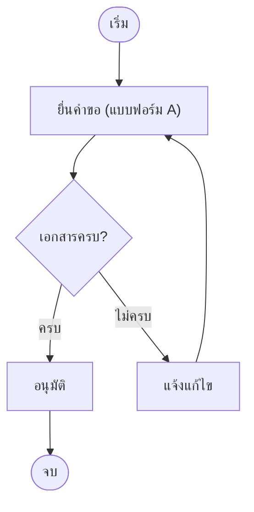

# เขียน Mermaid อย่างไรไม่ให้พัง

Mermaid block ใน Docs และ Wiki วาดแผนภาพจากข้อความที่คุณพิมพ์ ถ้าข้อความผิดรูปแบบ แผนภาพจะไม่ขึ้น และตอนแก้ไขจะมีกล่อง **Syntax error on line N** บอกบรรทัดที่ผิด ส่วนผู้อ่านจะเห็นเป็นข้อความดิบแทน

กฎข้างล่างนี้ป้องกันความผิดพลาดเกือบทั้งหมดได้

## 1. บรรทัดแรกต้องเป็นชนิดแผนภาพ

```text
flowchart TD
```

ชนิดที่ใช้บ่อย: `flowchart TD` (บนลงล่าง), `flowchart LR` (ซ้ายไปขวา), `sequenceDiagram`, `stateDiagram-v2`, `gantt`

- ห้ามมีข้อความใดอยู่ก่อนบรรทัดนี้
- ใส่เฉพาะเนื้อในของแผนภาพ **ไม่ต้อง** ใส่บรรทัด ```` ```mermaid ```` และ ```` ``` ```` ลงใน block

## 2. ID ใช้ภาษาอังกฤษ ข้อความไทยอยู่ในเครื่องหมายคำพูด

```text
A["รับคำขอ"] --> B["ตรวจสอบเอกสาร"]
```

- ID (เช่น `A`, `check`, `step2`) ห้ามมีช่องว่าง และห้ามเป็นภาษาไทย
- ข้อความที่มีอักขระ `( ) [ ] { } : ; , # / < >` **ต้อง** อยู่ใน `"..."` นี่คือสาเหตุที่พังบ่อยที่สุด

ผิด:

```text
A[ขั้นตอนที่ 1 (ยื่นเอกสาร)] --> B
```

ถูก:

```text
A["ขั้นตอนที่ 1 (ยื่นเอกสาร)"] --> B
```

## 3. ข้อความบนเส้นก็ใส่เครื่องหมายคำพูด

```text
B -->|"ผ่าน (OK)"| C
B -->|"ไม่ผ่าน"| D
```

## 4. คำที่ห้ามใช้เป็น ID

- `end` ตัวพิมพ์เล็กทั้งหมด จะถูกอ่านเป็นการปิด `subgraph` ให้ใช้ `End`, `done` หรือ `finish`
- ID ที่ขึ้นต้นด้วย `o` หรือ `x` ถ้าเขียนติดหลังเส้น เช่น `A---oB` จะถูกอ่านเป็นหัวเส้นแบบวงกลมหรือกากบาท ให้เว้นวรรค (`A --- oB`) หรือเปลี่ยนชื่อ ID

## 5. ระวังอักขระที่ติดมาจาก Word, LINE หรือเว็บ

- เครื่องหมายคำพูดโค้ง `“ ”` ต้องเปลี่ยนเป็น `"` ตรง
- ถ้าต้องการเครื่องหมาย `"` อยู่ในข้อความ ให้เขียนเป็น `#quot;`

## 6. โครงสร้างต้องปิดให้ครบ

- `subgraph ชื่อ` ต้องมี `end` ปิดทุกครั้ง
- comment ใช้ `%%` และต้องอยู่บรรทัดของตัวเอง

```text
subgraph s1["ฝ่ายรับเรื่อง"]
  A["รับคำขอ"] --> B["ลงทะเบียน"]
end
%% ส่งต่อให้ฝ่ายตรวจสอบ
B --> C["ตรวจสอบ"]
```

## 7. สิ่งที่ระบบนี้ปิดไว้

ใส่ไปก็ไม่ทำให้พัง แต่ไม่มีผล:

- `%%{init}%%` เปลี่ยนธีม สี หรือฟอนต์ไม่ได้ แผนภาพใช้สีและฟอนต์ของระบบเสมอ
- `click` และลิงก์ในแผนภาพไม่ทำงาน
- HTML ในข้อความไม่แสดงผล

แต่ละ block รับได้ไม่เกิน 50,000 ตัวอักษร

## แม่แบบที่ปลอดภัย

คัดลอกไปแก้ต่อได้เลย

```text
flowchart TD
  start(["เริ่ม"]) --> req["ยื่นคำขอ (แบบฟอร์ม A)"]
  req --> check{"เอกสารครบ?"}
  check -->|"ครบ"| approve["อนุมัติ"]
  check -->|"ไม่ครบ"| fix["แจ้งแก้ไข"]
  fix --> req
  approve --> done(["จบ"])
```

ผลที่ได้:



## ถ้ายังพัง

1. ดูกล่อง **Syntax error on line N** ใต้ block ตอนแก้ไข มันยกบรรทัดที่ผิดมาให้ และบอกว่า Mermaid คาดว่าจะเจออะไรตรงนั้น
2. ตรวจบรรทัดนั้นตามข้อ 2–5 ก่อน โดยเฉพาะวงเล็บและเครื่องหมายคำพูด
3. ถ้าบอกบรรทัดที่ 1 ให้ตรวจข้อ 1 ว่าบรรทัดแรกเป็นชนิดแผนภาพหรือไม่
