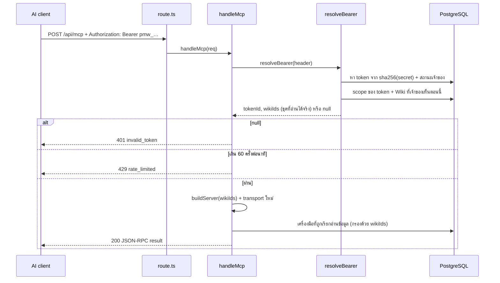

# MCP ของ Wiki ทำงานอย่างไร

เอกสารนี้สำหรับนักพัฒนาที่ต้องดูแลหรือแก้โค้ด MCP ของ Wiki — อธิบายว่าคำขอหนึ่งครั้งเดินทางผ่านอะไรบ้าง ใครตัดสินสิทธิ์ตรงไหน และจะเพิ่มหรือทดสอบเครื่องมือได้อย่างไร

ถ้าต้องการแค่ **เชื่อม AI เข้ากับ Wiki** (สร้าง token, ตั้งค่า Claude Code / Claude Desktop / VS Code / Cursor) ให้อ่าน [`wiki-mcp.md`](wiki-mcp.md) แทน ไฟล์นั้นแสดงในแอปที่ **Wiki → Tokens / MCP → How to connect** ด้วย กฎที่เป็นทางการอยู่ใน [`../spec/12-wiki.md`](../spec/12-wiki.md) §6–§8 (`D-77`…`D-81`)

---

## 1. ภาพรวม

MCP (Model Context Protocol) คือโปรโตคอลมาตรฐานที่ให้โปรแกรม AI เรียก "เครื่องมือ" (tools) ของระบบอื่นได้ ข้อความที่รับส่งเป็น JSON-RPC 2.0 ระบบนี้ใช้ MCP เป็น **ช่องทางเดียว** ที่ AI เข้าถึง Wiki ได้ โดยอ่านได้เป็นพื้นฐาน และสร้างหรือแก้ไขได้เมื่อ token มีสิทธิ์เพิ่มตาม [SRS](../spec/13-wiki-mcp-write-srs.md)

| เรื่อง | ค่าที่ใช้ |
|---|---|
| Endpoint | `POST /api/mcp` (ในแอป Next.js ตัวเดียวกัน ไม่มี process แยก) |
| Transport | Streamable HTTP แบบ **stateless** ตอบกลับเป็น JSON (`enableJsonResponse: true`) ไม่มี session id และไม่มี stream จากฝั่งเซิร์ฟเวอร์ |
| SDK | `@modelcontextprotocol/sdk` — `McpServer` + `WebStandardStreamableHTTPServerTransport` |
| การยืนยันตัวตน | `Authorization: Bearer pmw_…` **อย่างเดียว** ไม่อ่าน cookie ไม่รับ token ใน query string ไม่รับ secret ของลิงก์สาธารณะ |
| เครื่องมือ | อ่านพื้นฐาน 4 ตัวติด `readOnlyHint: true`; เพิ่ม `create_wiki`, `create_page`, `update_wiki`, `update_page` ตาม permission |
| อัตราการเรียก | 60 ครั้งต่อนาทีต่อ token (sliding window ในหน่วยความจำ) |
| `GET`, `DELETE` | `405` เพราะ stateless จึงไม่มี stream ให้เปิดและไม่มี session ให้ปิด |

## 2. ไฟล์ที่เกี่ยวข้อง

| ไฟล์ | หน้าที่ |
|---|---|
| `src/app/api/mcp/route.ts` | route ของ Next.js — ส่ง `POST` ต่อให้ `handleMcp` และตอบ `405` ให้ `GET`/`DELETE` ไม่เรียก `handle()` หรือ `currentUserId()` เลย cookie ของ session จึงไปไม่ถึงโค้ดส่วนนี้ |
| `src/lib/wiki-mcp.ts` | ตัวเซิร์ฟเวอร์ MCP: ตรวจ token, จำกัดอัตรา, สร้าง `McpServer`, ลงทะเบียนเครื่องมือตาม permissions และแปลงข้อผิดพลาด |
| `src/lib/wiki-tokens.ts` | `resolveBearer()` — แปลง header เป็น token และชุด Wiki ที่อ่านได้จริง (ทำทุกคำขอ) รวมถึงการสร้าง แก้ไข และ revoke token |
| `src/lib/wiki-rules.ts` | กฎแบบ pure function ที่ทดสอบได้โดยไม่ต้องมีฐานข้อมูล: `bearerSecret`, `hashTokenSecret`, `newTokenSecret`, `effectiveTokenWikis`, `tokenStatus`, `shouldTouchLastUsed`, `takeRateSlot` |
| `src/lib/wiki.ts` | ข้อมูลที่เครื่องมือใช้อ่าน: `visibleWikiIds`, `activeWikiPages`, `searchWikiIds` |
| `src/app/(signed-in)/wiki/tokens/` | หน้า **Tokens / MCP** และหน้า guide ที่อ่าน `docs/guides/wiki-mcp.md` มาแสดง |
| `db/migrations/021_wiki.sql` | ตาราง `pmt_wiki_tokens` และ `pmt_wiki_token_scopes` |

`src/proxy.ts` ไม่ยุ่งกับ `/api/mcp` เพราะ matcher ของมันข้ามทุกเส้นทางที่ขึ้นต้นด้วย `api`

## 3. เส้นทางของคำขอหนึ่งครั้ง



ทีละขั้น

1. **แยก secret ออกจาก header** — `bearerSecret()` รับเฉพาะรูปแบบ `Bearer pmw_<43 ตัวอักษร base64url>` เป๊ะ ๆ อย่างอื่นเป็น `null`
2. **หา token** — คำนวณ `sha256(secret)` แล้วค้นด้วย index ของ `wiki_token_hash` ในตารางเก็บเฉพาะ hash กับ prefix 8 ตัว **ไม่เคยเก็บ secret** (`D-77`)
3. **ตรวจว่ายังใช้ได้** — ต้องยังไม่ถูก revoke, ยังไม่หมดอายุ และบัญชีเจ้าของยัง active ถ้าไม่ผ่านข้อใด ผลคือ `null` แล้วตอบ `401` พร้อม `WWW-Authenticate: Bearer` ทุกกรณีตอบเหมือนกันหมด คนเรียกจึงแยกไม่ออกว่าผิดเพราะอะไร
4. **คำนวณ Wiki ที่อ่านได้จริง** (`D-78`)

   ```
   effective wikis = scope ของ token ∩ Wiki ที่เจ้าของ token มองเห็นอยู่ตอนนี้
   ```

   `visibleWikiIds(ownerId)` ใช้กฎเดียวกับหน้าเว็บ (`canSeeWiki`) ผลคือ ถ้าเจ้าของเสียสิทธิ์ใน Wiki ใด token ก็อ่าน Wiki นั้นไม่ได้ในคำขอถัดไปทันที โดยไม่ต้องลบ scope ทิ้ง ถ้าได้สิทธิ์คืน scope เดิมก็กลับมาใช้ได้เอง
5. **บันทึก `last_used_at`** — เขียนเฉพาะ token ที่ผ่านการตรวจ และไม่เกินนาทีละครั้ง เงื่อนไขซ้ำอยู่ใน SQL ด้วย คำขอสองอันที่มาพร้อมกันจึงเขียนแค่ครั้งเดียว
6. **จำกัดอัตรา** — `takeSlot()` เก็บเวลาที่เรียกของแต่ละ token ใน `Map` ในหน่วยความจำ ครั้งที่ 61 ภายใน 60 วินาทีได้ `429` พร้อม `Retry-After: 60` และ entry ที่ไม่ได้ใช้เกินหนึ่ง window จะถูกกวาดทิ้ง วิธีนี้ถูกต้องเพราะ deploy เป็น container เดียว (`D-81`, `08-operations.md`) ถ้าวันหนึ่งขยายเป็นหลาย instance ต้องย้ายตัวนับไปไว้ที่เก็บกลาง
7. **สร้างเซิร์ฟเวอร์ใหม่ทุกคำขอ** — `buildServer(wikiIds)` ผูกชุด Wiki ที่อ่านได้เข้ากับเครื่องมือทุกตัว แล้วต่อกับ transport ตัวใหม่ ตอบคำขอ แล้ว `server.close()` ไม่มีสถานะค้างข้ามคำขอเลย นี่คือความหมายของ stateless และเป็นเหตุผลที่ client เรียก `tools/call` ได้โดยไม่ต้อง `initialize` ก่อน

## 4. เครื่องมืออ่านพื้นฐานทั้ง 4 ตัว

ทุกตัวรับ `wikiIds` ที่ผ่านขั้นที่ 4 มาแล้วเท่านั้น และกรองซ้ำอีกชั้นว่า Wiki และหน้าต้องยังไม่ถูก archive

| เครื่องมือ | Input | ทำอะไร |
|---|---|---|
| `list_wikis` | — | `liveWikis(wikiIds)`: id, title, description, `pageCount` (นับเฉพาะหน้าที่ไม่ถูก archive) เรียงตามชื่อ |
| `list_pages` | `wiki_id` | `liveWiki()` ตรวจว่า Wiki อยู่ในชุดที่อ่านได้ แล้วส่งโครงหน้าตามลำดับในต้นไม้: id, slug, title, depth (1–3), parentId, updatedAt |
| `read_page` | `page_id` หรือ `wiki_id` + `slug` | หาหน้า ตรวจ Wiki ของมันอีกครั้ง แล้วส่ง title, wikiTitle, breadcrumb, updatedAt และ `markdown` ที่ได้จาก `contentMarkdown(body)` แผนภาพ Mermaid ออกมาเป็นบล็อก `` ```mermaid `` ซึ่งมีซอร์สตรงกับที่บันทึกไว้ทุก byte |
| `search` | `query`, `wiki_id`?, `limit`? | `searchWikiIds()` — ค้นแบบ substring ด้วย `ILIKE` บนชื่อและข้อความที่สกัดไว้ (`D-73`) ทุกคำต้องตรง หาคำไทยกลางประโยคได้ `limit` ถูกบีบให้อยู่ในช่วง 1–20 |

รายละเอียดที่ควรรู้

- **id ไม่สนตัวพิมพ์** UUID ถูกแปลงเป็นตัวพิมพ์เล็กก่อนเทียบ เพราะในฐานข้อมูลและในชุด `wikiIds` เป็นตัวเล็กทั้งหมด
- **id ที่รูปแบบผิดไม่ทำให้เกิด 500** `isUuid()` ตัดออกก่อนถึงฐานข้อมูล
- คำค้นผ่าน `likePattern()` ซึ่ง escape `%`, `_`, `\` และค่าเป็น bound parameter เสมอ ไม่มีการต่อสตริง SQL

## 5. ข้อผิดพลาดบอกอะไรได้บ้าง

ทุกเครื่องมือห่อด้วย `answer()`

| สถานการณ์ | สิ่งที่ client เห็น |
|---|---|
| ข้อมูลอยู่นอก scope, ถูก archive, ไม่มีอยู่จริง หรือ id ผิดรูปแบบ | ผลลัพธ์ `isError: true` ข้อความ `Not found.` — **เหมือนกันทุกกรณี** (`D-80`) จึงใช้เดาไม่ได้ว่า id ไหนมีอยู่จริง |
| ข้อผิดพลาดที่ไม่คาดคิด | log ที่เซิร์ฟเวอร์ด้วย `[mcp] <tool> failed` แล้วตอบข้อความตายตัว `The wiki could not answer this request.` ไม่มี stack trace ไม่มีข้อความจากฐานข้อมูล |
| token ใช้ไม่ได้ | HTTP `401 {"error":"invalid_token"}` |
| เรียกถี่เกิน | HTTP `429 {"error":"rate_limited"}` |
| เรียกเครื่องมือที่ไม่มี เช่น `create_page` | SDK ตอบเป็นข้อผิดพลาด เพราะไม่มีเครื่องมือเขียนให้เรียกเลย |

ผลลัพธ์ไม่เคยมีอีเมล ชื่อเจ้าของ หรือ secret ของลิงก์สาธารณะ

## 6. ลองเรียกด้วยมือ

สร้าง token ที่หน้า **Tokens / MCP** ก่อน แล้วใส่ใน `TOKEN` header `Accept` ต้องมีทั้ง `application/json` และ `text/event-stream` ตามข้อกำหนดของ Streamable HTTP

```bash
TOKEN=pmw_...
URL=http://localhost:3010/api/mcp

# เครื่องมือมีอะไรบ้าง
curl -s $URL -H "Authorization: Bearer $TOKEN" \
  -H 'content-type: application/json' -H 'accept: application/json, text/event-stream' \
  -d '{"jsonrpc":"2.0","id":1,"method":"tools/list"}'

# Wiki ที่ token อ่านได้
curl -s $URL -H "Authorization: Bearer $TOKEN" \
  -H 'content-type: application/json' -H 'accept: application/json, text/event-stream' \
  -d '{"jsonrpc":"2.0","id":2,"method":"tools/call","params":{"name":"list_wikis","arguments":{}}}'

# ค้นหา
curl -s $URL -H "Authorization: Bearer $TOKEN" \
  -H 'content-type: application/json' -H 'accept: application/json, text/event-stream' \
  -d '{"jsonrpc":"2.0","id":3,"method":"tools/call","params":{"name":"search","arguments":{"query":"ติดตั้ง"}}}'
```

ผลของ `tools/call` อยู่ที่ `result.content[0].text` เป็นสตริง JSON อีกชั้นหนึ่ง

ถ้าต้องการหน้าจอให้กด ใช้ MCP Inspector (`npx @modelcontextprotocol/inspector`) เลือก transport **Streamable HTTP** ใส่ URL ข้างบน และเพิ่ม header `Authorization: Bearer <token>`

## 7. การทดสอบ

| ชุด | ครอบคลุม | ต้องมี |
|---|---|---|
| `tests/wiki-rules.test.ts` | รูปแบบ token และ header, `effectiveTokenWikis` (revoke, หมดอายุ, เจ้าของถูกปิด, เสียสิทธิ์แล้วได้คืน), `takeRateSlot` | ไม่ต้องมีอะไร (`npm test`) |
| `tests/e2e/wiki-mcp.test.ts` | 24 กรณีผ่าน endpoint จริง: Bearer เท่านั้น, cookie และ secret ลิงก์สาธารณะใช้ไม่ได้, เครื่องมือครบ 4 ตัวและอ่านอย่างเดียว, id ตัวพิมพ์ใหญ่, scope ถูกตัดสินใหม่ทุกคำขอ, 401 เมื่อ revoke/หมดอายุ/ปิดบัญชี, injection, ไม่รั่ว stack trace, `last_used_at`, ครั้งที่ 61 ได้ 429 | ฐานข้อมูล + `npm run dev` |
| `tests/e2e/wiki-guide.test.ts` | หน้า guide ในแอปแสดง origin จริง เปิดได้เฉพาะคนที่ล็อกอิน และตัวอย่างทุกอันใน `wiki-mcp.md` ยัง parse และเชื่อมต่อได้ | ฐานข้อมูล + `npm run dev` |

```bash
npm test
npm run test:wiki   # รวม wiki-mcp และ wiki-guide
```

ชุด e2e สร้าง token ของตัวเองแยกในกรณีที่เรียกบ่อย เพื่อไม่ให้ใช้โควตา 60 ครั้งต่อนาทีของ token ที่ใช้ร่วมกันจนหมด

## 8. ถ้าจะเพิ่มเครื่องมือใหม่

1. เครื่องมือใหม่ต้องอยู่ในสิทธิ์ตาม SRS: อ่านพื้นฐาน หรือ `create_wiki`, `create_page`, `write_wiki`; ห้ามเพิ่มการลบหรือ archive
2. ลงทะเบียนใน `buildServer()` ด้วย `server.registerTool(name, { description, inputSchema, annotations: /* readOnly for reads, non-read-only for writes */ }, handler)` โดยกำหนด input ด้วย `zod`
3. เครื่องมืออ่านใช้ `liveWiki()` / `liveWikis()` กรอง `wikiIds` ส่วนเครื่องมือเขียนรับ context เต็มผ่าน `wiki-mcp-writes.ts` และตรวจทั้ง permission, scope และสิทธิ์ผู้ใช้ก่อนเขียน
4. ห่อด้วย `answer(name, …)` แล้ว throw `outOfScope()` เมื่อหาไม่เจอหรืออยู่นอกสิทธิ์ ข้อความ `Not found.` จะได้เหมือนกันทุกกรณี
5. อย่าส่งอีเมล ชื่อเจ้าของ หรือ `wiki_public_token` กลับไป
6. เพิ่มกรณีใช้ได้ใน scope, `Not found.` นอก scope, ถูก archive, id ผิดรูปแบบ และตรวจ tools ตาม permissions ใน `wiki-mcp-write.test.ts`; token พื้นฐานยังมีเพียงสี่ read tools
7. อัปเดตตารางเครื่องมือใน `docs/spec/12-wiki.md` §6, [`wiki-mcp.md`](wiki-mcp.md) §6 และในเอกสารนี้

## สิทธิ์เขียนระดับ token (2026-11-09)

`pmt_wiki_tokens` เพิ่ม `wiki_token_can_create_wiki`, `wiki_token_can_create_page`, `wiki_token_can_write_wiki` เป็น boolean NOT NULL DEFAULT false ใน migration 025. Token API ใช้ `permissions` array; create ที่ไม่ส่งได้ชุดว่าง และ edit ที่ไม่ส่งคงค่าเดิม ขณะที่ชุดว่างชัดเจนล้างสิทธิ์ได้ Wiki settings เปลี่ยน scope เท่านั้น

`resolveBearer` คืน permissions พร้อม tokenId/ownerId/wikiIds ที่คำนวณใหม่ทุก request. `wiki-mcp-writes.ts` ตรวจ permission และ scope ก่อนเรียก domain services; page IDs resolve Wiki จริงก่อนตรวจ authorization. `createWikiForToken` สร้าง Wiki พร้อม scope ใน transaction เดียว ไม่ให้สิทธิ์ token อื่น ส่วน metadata patch ตรวจชื่อและรายละเอียดครบก่อนอัปเดตครั้งเดียว ไม่ forward action ทั่วไป

การสร้างหน้าใช้ `create_page` และสิทธิ์เขียนของผู้ใช้ การแก้หน้าหรือรายละเอียด Wiki ใช้ `write_wiki` โดยรายละเอียด Wiki ต้องมี manage access การแก้หน้าส่ง `updatedAt` ผ่าน `saveWikiPage` เพื่อคง conflict, revisions และ search indexing. Tool schemas จำกัด fields; ไม่มี archive/delete/restore/member/publication/transfer/move/upload

`wiki-mcp-content.ts` ป้องกันการ flatten rich page ผ่าน Markdown export ที่สูญเสียรายละเอียด: no-op Markdown คง canonical body เดิม ส่วน Markdown ที่เปลี่ยนไปถูกปฏิเสธพร้อมคำแนะนำ ใช้ `read_page(include_rich_content: true)` เพื่อรับ `rich_content` แล้วส่ง canonical content ที่แก้ไขกลับใน `update_page` แทน `markdown` การอ่านที่ไม่ขอตัวเลือกนี้ยังคง response shape เดิม

ผลสำเร็จและ reads คง JSON text content เดิม Domain errors ของ writes ใช้ `isError: true` พร้อม `{error:{code,message}}`; stale save เป็น `E_DOC_CONFLICT` และแนะนำให้อ่านใหม่โดยไม่เปิดเผยชื่อผู้แก้ไข เป้าหมายนอก scope หรือ archived ยังคง `Not found.` Unexpected errors ไม่ส่ง SQL/stack trace

ทดสอบสิทธิ์อิสระทั้ง 8 ชุดและผลการเขียนจริงที่ `tests/e2e/wiki-mcp-write.test.ts`, migration/default ที่ `wiki-token-migration.test.ts` (ฐานข้อมูลท้องถิ่นแยกเท่านั้น), และ token UI ที่ `wiki.browser.test.ts`. Read-only tests เดิมใช้กับ token ที่ไม่มี optional permissions
