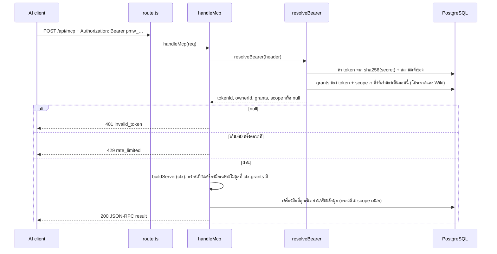

# MCP ของ T-Timeline ทำงานอย่างไร

เอกสารนี้สำหรับนักพัฒนาที่ต้องดูแลหรือแก้โค้ด MCP — อธิบายว่าคำขอหนึ่งครั้งเดินทางผ่านอะไรบ้าง ใครตัดสินสิทธิ์ตรงไหน เครื่องมือแต่ละโมดูลมีอะไรบ้าง และจะเพิ่มโมดูลหรือเครื่องมือใหม่ได้อย่างไร

ถ้าต้องการแค่ **เชื่อม AI เข้ากับระบบ** (สร้าง token, ตั้งค่า Claude Code / Claude Desktop / VS Code / Cursor) ให้อ่าน [`mcp.md`](mcp.md) แทน ไฟล์นั้นแสดงในแอปที่ **Tokens / MCP → How to connect** ด้วย กฎที่เป็นทางการอยู่ใน [`../spec/14-mcp-tokens.md`](../spec/14-mcp-tokens.md) (`D-90`…) ส่วนกฎของ Wiki เองที่ `D-70`–`D-76`, `D-82`–`D-85` ยังอยู่ใน [`../spec/12-wiki.md`](../spec/12-wiki.md)

---

## 1. ภาพรวม

MCP (Model Context Protocol) คือโปรโตคอลมาตรฐานที่ให้โปรแกรม AI เรียก "เครื่องมือ" (tools) ของระบบอื่นได้ ข้อความที่รับส่งเป็น JSON-RPC 2.0 ระบบนี้ใช้ MCP เป็น **ช่องทางเดียว** ที่ AI เข้าถึง List, Docs และ Wiki ได้ — token หนึ่งอันใช้ได้ทั้งสามโมดูล โดยอ่านได้เป็นพื้นฐานในทุกโมดูลที่เลือก และสร้างหรือแก้ไขได้เมื่อ token มีสิทธิ์เพิ่มต่อโมดูล (central MCP tokens design)

| เรื่อง | ค่าที่ใช้ |
|---|---|
| Endpoint | `POST /api/mcp` (ในแอป Next.js ตัวเดียวกัน ไม่มี process แยก) — ทุกโมดูลผ่านจุดเดียวกัน |
| ชื่อเซิร์ฟเวอร์ | `t-timeline` (เดิมคือ `t-timeline-wiki` ตอนยังผูกกับ Wiki อย่างเดียว) |
| Transport | Streamable HTTP แบบ **stateless** ตอบกลับเป็น JSON (`enableJsonResponse: true`) ไม่มี session id และไม่มี stream จากฝั่งเซิร์ฟเวอร์ |
| SDK | `@modelcontextprotocol/sdk` — `McpServer` + `WebStandardStreamableHTTPServerTransport` |
| การยืนยันตัวตน | `Authorization: Bearer pmw_…` **อย่างเดียว** ไม่อ่าน cookie ไม่รับ token ใน query string |
| เครื่องมือ | อ่านพื้นฐานของทุกโมดูลที่ token มี ติด `readOnlyHint: true`; เครื่องมือเขียนลงทะเบียนเฉพาะเมื่อ token มี grant นั้น |
| อัตราการเรียก | 60 ครั้งต่อนาทีต่อ token (sliding window ในหน่วยความจำ) **รวมทุกโมดูล** |
| `GET`, `DELETE` | `405` เพราะ stateless จึงไม่มี stream ให้เปิดและไม่มี session ให้ปิด |

## 2. ไฟล์ที่เกี่ยวข้อง

| ไฟล์ | หน้าที่ |
|---|---|
| `src/app/api/mcp/route.ts` | route ของ Next.js — ส่ง `POST` ต่อให้ `handleMcp` และตอบ `405` ให้ `GET`/`DELETE` ไม่เรียก `handle()` หรือ `currentUserId()` เลย cookie ของ session จึงไปไม่ถึงโค้ดส่วนนี้ |
| `src/lib/mcp/server.ts` | `handleMcp()` — ตรวจ token, จำกัดอัตรา, สร้าง `McpServer` ใหม่ทุกคำขอ แล้วเรียก `register*Tools` ของแต่ละโมดูลที่ token มี |
| `src/lib/mcp/tool-kit.ts` | สิ่งที่ทุกโมดูลใช้ร่วมกัน: `McpContext` (= `McpAuth`), `answer()` ที่ห่อ handler และแปลง error, `outOfScope()`, `readOnly`/`writes` annotations |
| `src/lib/mcp/list-tools.ts` | เครื่องมือของ List: `list_projects` (ใช้ร่วมกับ Docs), `list_tasks`, `read_task`, `create_task`, `update_task` |
| `src/lib/mcp/docs-tools.ts` | เครื่องมือของ Docs: `list_docs`, `list_doc_pages`, `read_doc_page`, `create_doc`, `create_doc_page`, `update_doc_page` |
| `src/lib/mcp/wiki-tools.ts` | เครื่องมือของ Wiki (ชื่อเดิมทุกตัว): `list_wikis`, `list_pages`, `read_page`, `search`, `create_wiki`, `create_page`, `update_wiki`, `update_page` |
| `src/lib/mcp/wiki-writes.ts` | ฟังก์ชันเขียนของ Wiki ที่ตรวจ permission, scope และสิทธิ์ผู้ใช้ก่อนเรียก `wiki.ts` |
| `src/lib/mcp-rules.ts` | กฎแบบ pure function ของ List และ Docs: `scopedId`, `taskPatch`, `docPageContent` |
| `src/lib/wiki-mcp-content.ts` | `mcpPageContent()` — กันไม่ให้ Markdown export ทับ rich content ของหน้า Docs หรือ Wiki แบบ flatten เงียบ ๆ ใช้ร่วมกันโดยทั้งสองโมดูล |
| `src/lib/token-modules.ts` | **registry ของโมดูล** — `TOKEN_MODULES`, คีย์ ป้ายชื่อ และสิทธิ์ของแต่ละโมดูล, `hasModule`/`hasGrant`/`scopeKindsInUse` อ่าน client-safe ไม่พึ่ง `node:crypto` |
| `src/lib/token-rules.ts` | กฎ pure function ที่เหลือ (secret, scope, rate limiter) — re-export ทุกอย่างจาก `token-modules.ts` ด้วย |
| `src/lib/access-tokens.ts` | adapter ฐานข้อมูล: `resolveBearer()`, `createToken`, `updateToken`, `revokeToken`, `listMyTokens`, `listAllTokens`, `allowWikiOnMyTokens` |
| `src/lib/project-access.ts` | `visibleProjects`/`visibleProjectIds` — โปรเจกต์ที่ผู้ใช้เป็นสมาชิกอยู่ตอนนี้ ใช้คำนวณ effective scope ของ List/Docs เหมือนที่ `visibleWikiIds` ทำให้ Wiki |
| `src/app/(signed-in)/tokens/` | หน้า **Tokens / MCP** (stepper 4 ขั้น) และหน้า guide ที่อ่าน `docs/guides/mcp.md` มาแสดง — ย้ายออกจาก Wiki แล้ว, `/wiki/tokens` และ `/wiki/tokens/guide` เหลือแค่ redirect |
| `db/migrations/026_access_tokens.sql` | เปลี่ยน `pmt_wiki_tokens`/`pmt_wiki_token_scopes` เป็น `pmt_access_tokens`, `pmt_access_token_grants`, `pmt_access_token_scopes` |

`src/proxy.ts` ไม่ยุ่งกับ `/api/mcp` เพราะ matcher ของมันข้ามทุกเส้นทางที่ขึ้นต้นด้วย `api`

## 3. เส้นทางของคำขอหนึ่งครั้ง



ทีละขั้น

1. **แยก secret ออกจาก header** — `bearerSecret()` รับเฉพาะรูปแบบ `Bearer pmw_<43 ตัวอักษร base64url>` เป๊ะ ๆ อย่างอื่นเป็น `null`
2. **หา token** — คำนวณ `sha256(secret)` แล้วค้นด้วย index ของ `access_token_hash` ในตารางเก็บเฉพาะ hash กับ prefix 8 ตัว **ไม่เคยเก็บ secret**
3. **ตรวจว่ายังใช้ได้** — ต้องยังไม่ถูก revoke, ยังไม่หมดอายุ และบัญชีเจ้าของยัง active ถ้าไม่ผ่านข้อใด ผลคือ `null` แล้วตอบ `401` พร้อม `WWW-Authenticate: Bearer` ทุกกรณีตอบเหมือนกันหมด คนเรียกจึงแยกไม่ออกว่าผิดเพราะอะไร
4. **โหลด grants และคำนวณ scope ที่ใช้ได้จริง**

   ```
   effective scope = scope ของ token ∩ สิ่งที่เจ้าของ token มองเห็นอยู่ตอนนี้
   ```

   ต่อขอบเขตแต่ละชนิด: `visibleProjectIds(ownerId)` สำหรับโปรเจกต์ (List และ Docs ใช้ร่วมกัน) และ `visibleWikiIds(ownerId)` สำหรับ Wiki ผลคือ ถ้าเจ้าของเสียสิทธิ์ที่ใด token ก็ทำสิ่งนั้นไม่ได้ในคำขอถัดไปทันที โดยไม่ต้องลบ scope ทิ้ง ถ้าได้สิทธิ์คืน scope เดิมก็กลับมาใช้ได้เอง `effectiveScope()` (`token-rules.ts`) ทำสิ่งนี้ให้ทั้งสองขอบเขตพร้อมกัน
5. **บันทึก `last_used_at`** — เขียนเฉพาะ token ที่ผ่านการตรวจ และไม่เกินนาทีละครั้ง เงื่อนไขซ้ำอยู่ใน SQL ด้วย คำขอสองอันที่มาพร้อมกันจึงเขียนแค่ครั้งเดียว
6. **จำกัดอัตรา** — `takeSlot()` เก็บเวลาที่เรียกของแต่ละ token ใน `Map` ในหน่วยความจำ รวมทุกโมดูลไว้นับเดียวกัน ครั้งที่ 61 ภายใน 60 วินาทีได้ `429` พร้อม `Retry-After: 60` และ entry ที่ไม่ได้ใช้เกินหนึ่ง window จะถูกกวาดทิ้ง วิธีนี้ถูกต้องเพราะ deploy เป็น container เดียว ถ้าวันหนึ่งขยายเป็นหลาย instance ต้องย้ายตัวนับไปไว้ที่เก็บกลาง
7. **สร้างเซิร์ฟเวอร์ใหม่ทุกคำขอ** — `buildServer(ctx)` (`src/lib/mcp/server.ts`) ลงทะเบียนเฉพาะโมดูลที่ `ctx.grants` มี: `list_projects` ใช้ร่วมกันระหว่าง List กับ Docs จึงลงทะเบียนครั้งเดียวถ้ามีโมดูลใดโมดูลหนึ่ง แล้วต่อกับ transport ตัวใหม่ ตอบคำขอ แล้ว `server.close()` ไม่มีสถานะค้างข้ามคำขอเลย นี่คือความหมายของ stateless และเป็นเหตุผลที่ client เรียก `tools/call` ได้โดยไม่ต้อง `initialize` ก่อน

## 4. เครื่องมือแต่ละโมดูล

ทุกเครื่องมือรับ `ctx: McpContext` (= `McpAuth`: `tokenId`, `ownerId`, `grants`, `scope`) ที่ผ่านขั้นที่ 4 มาแล้ว และกรองซ้ำอีกชั้นว่าแถวต้องยังไม่ถูก archive และอยู่ในขอบเขตจริง (`scopedId`, `scopedNode`, `scopedDoc`, `scopedPage`, `liveWiki` ฯลฯ)

### List (`list-tools.ts`)

| เครื่องมือ | สิทธิ์ | ทำอะไร |
|---|---|---|
| `list_projects` | อ่าน | `visibleProjects(ownerId)` กรองด้วย `scope.projectIds` — ใช้ร่วมกับ Docs |
| `list_tasks` | อ่าน | `loadLedger()` กรองเหลือ `depth >= 2` (ไม่รวม root ของโปรเจกต์) ส่ง estimate/actual เป็นคนละฟิลด์ |
| `read_task` | อ่าน | หนึ่งแถวจาก ledger เดียวกัน |
| `create_task` | `create_task` | `authorize(..., 'node.create')` แล้ว `createNode()` |
| `update_task` | `write_task` | แก้ไขหรือย้าย อย่างใดอย่างหนึ่งต่อคำขอ (`taskPatch()` ตัดเฉพาะคีย์ที่ส่งมา); แก้วันที่ต้อง `node.editDates`, แก้ values ต้อง `node.editValues`, เปลี่ยนชื่อต้อง `node.rename`, ย้ายต้อง `node.move` — grant ไม่เคยแทนที่ role ของเจ้าของเลย |

Defects (`WorkKind` `defect`) ไม่อยู่ใน `list_tasks`/`read_task` เพราะ ledger ที่ใช้ไม่รวม defect node และ `scopedNode` ตรวจ depth กับ archived เท่านั้น ไม่มี adapter แยกให้ MCP แตะ Defects เลยในรุ่นนี้

### Docs (`docs-tools.ts`)

| เครื่องมือ | สิทธิ์ | ทำอะไร |
|---|---|---|
| `list_docs` | อ่าน | `listDocs(ownerId, projectId)` |
| `list_doc_pages` | อ่าน | `loadDoc()` แล้วส่งต้นไม้ของหน้า |
| `read_doc_page` | อ่าน | ส่งแต่ละ section เป็น `contentMarkdown()`; `include_rich_content` แนบ `rich_content` ด้วยถ้าเป็น rich |
| `create_doc` | `create_doc` | สร้างเอกสารใหม่ |
| `create_doc_page` | `create_page` | สร้างหน้า Free ใหม่ |
| `update_doc_page` | `write_page` | แก้หนึ่ง section ผ่าน `docPageContent()` (`mcp-rules.ts`) ซึ่งเรียก `mcpPageContent()` ร่วมกับ Wiki แล้วตรวจด้วย `removedDocAssetIds()` ว่าไม่มีไฟล์แนบหาย |

`docs.ts` เป็นคนตรวจสิทธิ์ของเจ้าของ token เอง (`doc.create`, `doc.edit` ฯลฯ) เหมือน route ของแอป MCP ไม่เพิ่ม path ใหม่ให้เขียนเอกสาร

### Wiki (`wiki-tools.ts`, `wiki-writes.ts`)

ชื่อเครื่องมือ **เดิมทุกตัว** ไม่เปลี่ยน แม้ token จะกลายเป็นระบบเดียว: `list_wikis`, `list_pages`, `read_page`, `search`, `create_wiki`, `create_page`, `update_wiki`, `update_page` — client ที่ตั้งค่าไว้ก่อน task นี้ยังเชื่อมต่อได้โดยไม่ต้องแก้อะไร รายละเอียดเดิมอยู่ใน [`../spec/12-wiki.md`](../spec/12-wiki.md) §6

รายละเอียดที่ควรรู้ ใช้ร่วมกันทุกโมดูล

- **id ไม่สนตัวพิมพ์** UUID ถูกแปลงเป็นตัวพิมพ์เล็กก่อนเทียบ เพราะในฐานข้อมูลและใน scope เป็นตัวเล็กทั้งหมด (`isUuid`, `scopedId`)
- **id ที่รูปแบบผิดไม่ทำให้เกิด 500** ตรวจรูปแบบก่อนถึงฐานข้อมูลเสมอ
- คำค้นผ่าน parameter ที่ bind เสมอ ไม่มีการต่อสตริง SQL

## 5. ข้อผิดพลาดบอกอะไรได้บ้าง

ทุกเครื่องมือห่อด้วย `answer()` (`tool-kit.ts`)

| สถานการณ์ | สิ่งที่ client เห็น |
|---|---|
| ข้อมูลอยู่นอก scope, ถูก archive, ไม่มีอยู่จริง หรือ id ผิดรูปแบบ (`OutOfScope`) | ผลลัพธ์ `isError: true` ข้อความ `Not found.` — **เหมือนกันทุกกรณี ทุกโมดูล** จึงใช้เดาไม่ได้ว่า id ไหนมีอยู่จริง |
| `DomainError` อื่น (เช่น `E_INVALID_DOC`, `E_DOC_CONFLICT`) | `isError: true` พร้อม `{error:{code,message}}`; `E_DOC_CONFLICT` ถูกแทนข้อความด้วย "This page changed. Read it again before retrying your edit." เสมอ ไม่บอกว่าใครแก้ |
| ข้อผิดพลาดที่ไม่คาดคิด | log ที่เซิร์ฟเวอร์ด้วย `[mcp] <tool> failed` แล้วตอบข้อความตายตัว **"The server could not answer this request."** ไม่มี stack trace ไม่มีข้อความจากฐานข้อมูล (ข้อความนี้ไม่เอ่ยชื่อเครื่องมือใดเจาะจง ก่อนหน้านี้ข้อความของ rich content เคยเอ่ยชื่อ `read_page` ซึ่งทำให้ caller ของ Docs เข้าใจผิดว่าต้องเรียกเครื่องมือของ Wiki — แก้แล้วให้ไม่เจาะจงเครื่องมือ) |
| token ใช้ไม่ได้ | HTTP `401 {"error":"invalid_token"}` |
| เรียกถี่เกิน | HTTP `429 {"error":"rate_limited"}` |
| เรียกเครื่องมือที่ไม่มี เช่น token ไม่มีโมดูลนั้นหรือไม่มี grant | SDK ตอบเป็นข้อผิดพลาด เพราะไม่มีเครื่องมือนั้นให้เรียกเลย |

ผลลัพธ์ไม่เคยมีอีเมล ชื่อเจ้าของ หรือ secret ของลิงก์สาธารณะ

## 6. ลองเรียกด้วยมือ

สร้าง token ที่หน้า **Tokens / MCP** ก่อน แล้วใส่ใน `TOKEN` header `Accept` ต้องมีทั้ง `application/json` และ `text/event-stream` ตามข้อกำหนดของ Streamable HTTP

```bash
TOKEN=pmw_...
URL=http://localhost:3010/api/mcp

# เครื่องมือมีอะไรบ้าง (ขึ้นกับโมดูลและสิทธิ์ของ token นี้)
curl -s $URL -H "Authorization: Bearer $TOKEN" \
  -H 'content-type: application/json' -H 'accept: application/json, text/event-stream' \
  -d '{"jsonrpc":"2.0","id":1,"method":"tools/list"}'

# โปรเจกต์ที่ token อ่านได้ (ต้องมีโมดูล List หรือ Docs)
curl -s $URL -H "Authorization: Bearer $TOKEN" \
  -H 'content-type: application/json' -H 'accept: application/json, text/event-stream' \
  -d '{"jsonrpc":"2.0","id":2,"method":"tools/call","params":{"name":"list_projects","arguments":{}}}'

# ค้นใน Wiki (ต้องมีโมดูล Wiki)
curl -s $URL -H "Authorization: Bearer $TOKEN" \
  -H 'content-type: application/json' -H 'accept: application/json, text/event-stream' \
  -d '{"jsonrpc":"2.0","id":3,"method":"tools/call","params":{"name":"search","arguments":{"query":"ติดตั้ง"}}}'
```

ผลของ `tools/call` อยู่ที่ `result.content[0].text` เป็นสตริง JSON อีกชั้นหนึ่ง

ถ้าต้องการหน้าจอให้กด ใช้ MCP Inspector (`npx @modelcontextprotocol/inspector`) เลือก transport **Streamable HTTP** ใส่ URL ข้างบน และเพิ่ม header `Authorization: Bearer <token>`

## 7. การทดสอบ

| ชุด | ครอบคลุม | ต้องมี |
|---|---|---|
| `tests/token-rules.test.ts` | registry ของโมดูล, grants/scope เป็น pure function, secret/status/rate limiter | ไม่ต้องมีอะไร (`npm test`) |
| `tests/mcp-rules.test.ts` | `scopedId`, `taskPatch` (estimate/actual แยกกันเสมอ), `docPageContent` | ไม่ต้องมีอะไร (`npm test`) |
| `tests/e2e/tokens.test.ts` | `/api/tokens` ผ่าน session: grants ต่อโมดูล, scope ต่อชนิด, การตัด scope ที่ไม่มีโมดูลใช้แล้ว | ฐานข้อมูล + `npm run dev` |
| `tests/e2e/tokens.browser.test.ts` | stepper จริงในเบราว์เซอร์: Modules → Permissions → Where → Name, Read ล็อกไว้, Select all, แก้ไขแล้วหลุดโมดูล, `/wiki/tokens` redirect | ฐานข้อมูล + `npm run dev` |
| `tests/e2e/mcp-list.test.ts` | เครื่องมือ List ผ่าน endpoint จริง: grant ไม่เคยเกิน role, out-of-scope, สมาชิกภาพหลุด/กลับมา, แจ้งเตือนเมื่อ assign | ฐานข้อมูล + `npm run dev` |
| `tests/e2e/mcp-docs.test.ts` | เครื่องมือ Docs ผ่าน endpoint จริง: `create_doc` ต้อง Admin, stale `updatedAt`, ห้ามลบไฟล์แนบ, หน้าที่ป้องกันไว้แก้ไม่ได้ | ฐานข้อมูล + `npm run dev` |
| `tests/e2e/access-token-migration.test.ts` | migration 026: token เก่าได้ `wiki:read` บวก grant ตาม boolean เดิม, คง scope, ชื่อ constraint/index ตรงกับ `db:build` | PostgreSQL แบบ loopback เท่านั้น (สร้าง/ลบฐานข้อมูลของตัวเอง) |
| `tests/e2e/wiki-mcp.test.ts`, `tests/e2e/wiki-mcp-write.test.ts` | เครื่องมือ Wiki (อ่านและเขียน) เหมือนก่อนย้าย | ฐานข้อมูล + `npm run dev` |
| `tests/e2e/wiki-guide.test.ts` | หน้า guide ที่ `/tokens/guide` แสดง origin จริง เปิดได้เฉพาะคนที่ล็อกอิน ตัวอย่างทุกอันใน `mcp.md` ยัง parse และเชื่อมต่อได้ และ `/wiki/tokens/guide` เก่า redirect มาที่นี่ | ฐานข้อมูล + `npm run dev` |

```bash
npm test       # token-rules, mcp-rules รวมอยู่ใน 541 domain rule tests
npm run test:mcp    # tokens, tokens-browser, mcp-list, mcp-docs, access-token-migration
npm run test:wiki   # รวม wiki-mcp, wiki-mcp-write และ wiki-guide
```

`access-token-migration.test.ts` ข้าม (skip) ตัวเองพร้อมบอกเหตุผล ถ้า `PGHOST` ไม่ใช่ `127.0.0.1`/`localhost`/`::1` แทนที่จะ fail เพราะมันสร้างและลบฐานข้อมูลทดสอบของตัวเอง จึงปลอดภัยที่จะรันร่วมกับฐานข้อมูลพัฒนาที่ใช้ร่วมกัน (เช่นผ่าน `npm run test:mcp`) — ได้ผลข้าม 1 รายการแทนที่จะ fail รันแยกกับ loopback PostgreSQL เพื่อให้เครื่องมือ migration เองได้ตรวจจริง ชุด e2e อื่นสร้าง token ของตัวเองแยกในกรณีที่เรียกบ่อย เพื่อไม่ให้ใช้โควตา 60 ครั้งต่อนาทีของ token ที่ใช้ร่วมกันจนหมด

## 8. ถ้าจะเพิ่มโมดูลใหม่

การออกแบบนี้ตั้งใจให้เพิ่มโมดูลโดย **ไม่ต้อง migration เพิ่มคอลัมน์**: grant และ scope เป็นแถว ไม่ใช่คอลัมน์ boolean แล้ว

1. **ประกาศโมดูลใน `src/lib/token-modules.ts`** — เพิ่มสมาชิกใหม่ใน `TOKEN_MODULES`: คีย์ (`key`), ป้ายชื่อ, คำอธิบาย Read (`readHint`), ชนิดของ scope (`scope`: `'project'` หรือชนิดใหม่ที่โมดูลเป็นเจ้าของ เช่น `'wiki'`) และรายการสิทธิ์ Create/Write ของมัน (`permissions`) — stepper, การตรวจ grant, การเก็บ scope และการลงทะเบียนเครื่องมือ **อ่าน declaration นี้ที่เดียว** ไม่ต้องแก้ที่อื่นเพื่อให้โมดูลปรากฏในหน้า Tokens / MCP
2. **ถ้า scope เป็นชนิดใหม่** (ไม่ใช่ `project` และไม่ใช่ `wiki`) เพิ่มคอลัมน์ nullable หนึ่งคอลัมน์ใน `pmt_access_token_scopes` (เหมือน `token_scope_project_id`/`token_scope_wiki_id`) พร้อม unique index และ `CHECK (num_nonnulls(...) = 1)` ที่ขยายให้นับคอลัมน์ใหม่ด้วย แล้วเพิ่มเข้า `SCOPE_KINDS` ใน `access-tokens.ts` และฟังก์ชัน "visible ตอนนี้" แบบเดียวกับ `visibleProjectIds`/`visibleWikiIds`
3. **เขียนกฎล้วน (pure)** ที่ไม่พึ่งฐานข้อมูลก่อน ถ้าโมดูลต้องแปลง id หรือ patch ก็ใส่ไว้ใน `mcp-rules.ts` และทดสอบใน `tests/mcp-rules.test.ts` แบบเดียวกับ `scopedId`/`taskPatch`/`docPageContent`
4. **เขียน `src/lib/mcp/<module>-tools.ts`** หนึ่งไฟล์ export ฟังก์ชันเดียวชื่อ `register<Module>Tools(server, ctx)` — เครื่องมืออ่านลงทะเบียนเสมอ (มี grant นี้แปลว่ามีโมดูลนี้); เครื่องมือเขียนลงทะเบียนเฉพาะหลัง `if (hasGrant(ctx.grants, '<module>', '<permission>'))` ทุกตัวห่อด้วย `answer(name, …)` จาก `tool-kit.ts` และ `throw outOfScope()` เมื่อหาไม่เจอหรืออยู่นอกสิทธิ์ ไม่มีการเขียนทับงานของใคร ไม่มีการลบ/archive และห้ามส่งอีเมล ชื่อเจ้าของ หรือความลับกลับไป (ตาม non-goals ของ design)
5. **ต่อสายใน `src/lib/mcp/server.ts`** — เพิ่มบรรทัดเดียวใน `buildServer()`: `if (hasModule(ctx.grants, '<module>')) register<Module>Tools(server, ctx);`
6. **ทดสอบ** เพิ่มชุด `tests/e2e/mcp-<module>.test.ts` ตามแบบ `mcp-list.test.ts`/`mcp-docs.test.ts`: มีสิทธิ์ใน scope ได้, นอก scope เป็น `Not found.`, grant ไม่เกิน role ของเจ้าของ, สมาชิกภาพหลุดแล้วหยุดทันที, ไม่มีการลบ/archive ผ่าน MCP
7. **อัปเดตเอกสาร** — ตารางเครื่องมือใน [`mcp.md`](mcp.md) §6 และในเอกสารนี้ §4, และเพิ่มการตัดสินใจที่เกี่ยวข้องใน [`../spec/14-mcp-tokens.md`](../spec/14-mcp-tokens.md) ถ้ากติกาเปลี่ยน
